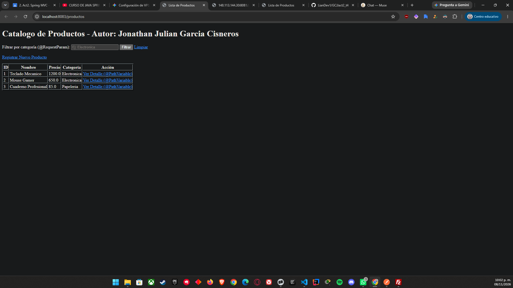
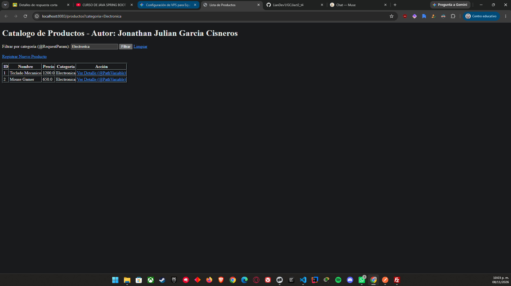
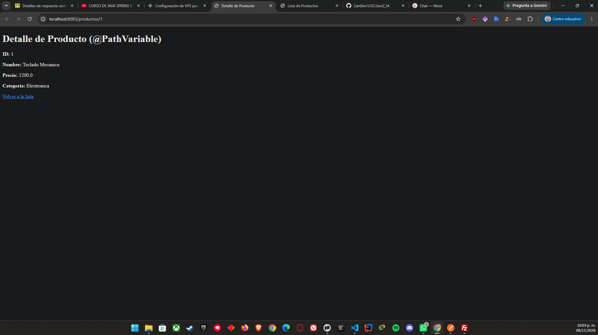
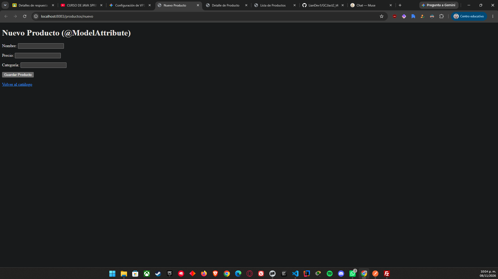
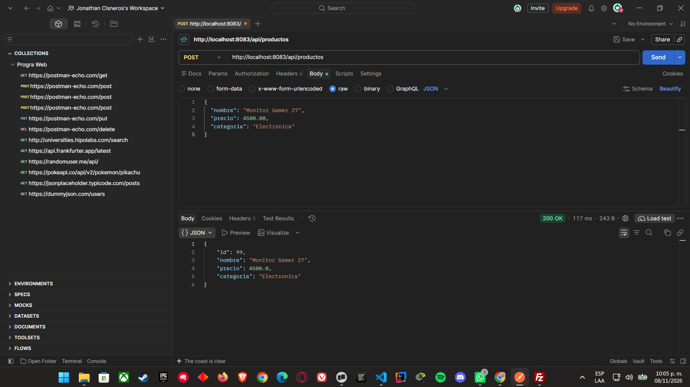
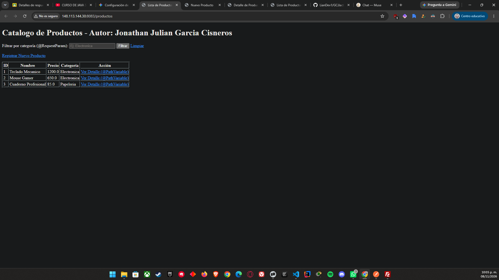

# Actividad 2: Desarrollo Web con Spring Boot MVC, Thymeleaf y API REST

**Autor:** Jonathan Julian Garcia Cisneros  
**Repositorio:** `GCJJact2_t4`  
**Servidor VPS:** `http://148.113.144.30:8083/productos`  

---

## 📋 Descripción del Proyecto
Aplicación web desarrollada con **Spring Boot** y **Thymeleaf** para la gestión de productos, incorporando controladores MVC y un servicio web RESTful. El proyecto está desplegado de forma independiente en un VPS Linux (Ubuntu) utilizando Java 21 y ejecutándose en el puerto `8083`.

---

## 🛠️ Tecnologías Utilizadas
* **Lenguaje:** Java 21
* **Framework:** Spring Boot 3.x / 4.x (Spring MVC, Spring Web)
* **Motor de Plantillas:** Thymeleaf
* **Gestor de Dependencias:** Apache Maven
* **Cliente REST:** Postman
* **Servidor y Despliegue:** VPS Linux (Nohup / SSH)

---

## 📌 Endpoints del Sistema

| Tipo | Método | URL | Descripción |
| :--- | :--- | :--- | :--- |
| **MVC** | `GET` | `/productos` | Lista productos o filtra por `?categoria=`. Muestra el autor mediante `@Value`. |
| **MVC** | `GET` | `/productos/{id}` | Muestra el detalle de un producto específico mediante `@PathVariable`. |
| **MVC** | `GET` | `/productos/nuevo` | Formulario HTML para registrar un nuevo producto. |
| **MVC** | `POST` | `/productos/guardar` | Procesa y almacena el formulario mediante `@ModelAttribute`. |
| **REST** | `POST` | `/api/productos` | Endpoint `@RestController` que recibe un JSON y retorna el `ProductoDTO` procesado. |

---

## 📸 Evidencias de Funcionamiento

### 1. Listado General y Autor (`th:each` y `@Value`)


### 2. Filtrado por Categoría (`@RequestParam`)


### 3. Detalle de Producto (`@PathVariable`)


### 4. Formulario de Alta (`@ModelAttribute`)


### 5. Consumo de API REST en Postman (`@RestController`)


### 6. Despliegue en VPS en Vivo


---

## 🚀 Instrucciones de Ejecución Local
1. Clonar el repositorio:
   ```bash
   git clone [https://github.com/LianDev1/GCJJact2_t4.git](https://github.com/LianDev1/GCJJact2_t4.git)
   cd GCJJact2_t4